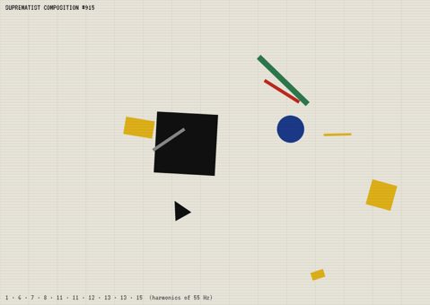

# GENERATIVE PATTERNS

There are twenty generative music machines in this repo. Each is driven by one rule taken from **maths**, **nature**, **history** or **art**, and seven of them come from famous **art manifestos**, with the manifesto's rules turned into music-making constraints.

**▶ Live gallery:** https://anorthernman-developer.github.io/generative-patterns/



Each project is a **single self-contained HTML file**. The JS, CSS and fonts are inlined, and there is no build step, server or install. Download any file from `projects/`, double-click it, and it runs in Chrome or Edge.

## What every project has

- **The rule shown on the page:** a sidebar explains the pattern and quotes or paraphrases the source (manifesto, treatise, paper).
- **Its own visual:** the picture draws the process that is making the music.
- **Built-in synth voices** (pluck, marimba, glass, bell, organ, reed, pad, bass, drums and more), plus custom voices where the concept needs them: intonarumori noise machines, prepared piano and bird syllables.
- **Your own samples:** use **FILES** or **FOLDER** (point it at e.g. `F:\01 Splice Sounds`; up to 16 random files from the folder are loaded) or drag files onto the stage. Choose the source mode: *pitched* (each lane's sample is repitched to the note), *by note* or *by lane*.
- **MIDI out** through Web MIDI: pick an output and each lane goes out on its own channel.
- **WAV recording:** **● REC** captures the master output to a 16-bit stereo WAV.
- **Gemini (optional):** see below.

## How Gemini is used

Gemini **never makes audio** and **never runs the clock**. In each project it plays one specific role: it writes a grammar, chart, map, table or score as **structured JSON**, and the project's own deterministic engine checks it, clamps it and then plays it.

- Requests go to `v1beta/models/{model}:generateContent` with `responseMimeType: application/json` and a per-project `responseJsonSchema`. If the model rejects the schema, the request is retried without it, and the reply is parsed leniently.
- **Model fallbacks:** `gemini-3.8-flash` → `gemini-3.5-flash-lite` → `gemini-flash-latest` → `gemini-3.6-flash`. You can choose a model on the page; it is remembered in `localStorage` as `gp.geminiModel`.
- **Your key** is stored only in your browser (`localStorage['sr12.geminiKey']`, the same key as the SR-12 looper) and is sent only to `generativelanguage.googleapis.com`. **FORGET KEY** removes it.
- **No key? Everything still works.** Each project has a fully algorithmic fallback (its own grammar, chart, map or score generator), and many of them use your prompt text as a seed. For example, *Isorhythm* turns your words into chant using Guido's vowel method, and *Wall Drawing* parses your instruction with a keyword parser.
- Several projects deliberately limit what Gemini is allowed to decide, as part of the concept:
  - *Dada Cut-Up:* Gemini only writes the newspaper, and the bag decides the order.
  - *Music of Changes:* Gemini supplies only the gamut, and the coins decide everything else.
  - *Exquisite Corpse:* each fold is a separate call that sees only the previous tail.
  - *Würfelspiel:* the dice still choose the bars.

## The twenty

### Maths

| # | Project | The rule | What Gemini does |
|---|---|---|---|
| 01 | [INTEGER CHOIR](https://anorthernman-developer.github.io/generative-patterns/projects/01-integer-choir.html) | Four voices each sing an integer sequence (Recamán, Collatz, Thue–Morse, digits of pi, primes, Fibonacci mod n) written as one-line recurrence formulas; the value picks the scale degree, negative values rest. | Invents brand-new integer recurrences in a small safe formula language from your description, which the app parses, checks and sings. |
| 02 | [L-SYSTEM GARDEN](https://anorthernman-developer.github.io/generative-patterns/projects/02-lsystem-garden.html) | Lindenmayer grammars rewrite a string again and again (F → FF, X → F+[[X]-X]-F[-FX]+X); a turtle draws it as a plant, fractal or Penrose tiling and the same string is read as a score: F plays, + and − step the scale, [ ] branch into new voices. | Writes new L-system grammars (axiom, rules, angle, depth) from a text prompt; the app validates the alphabet, caps growth and draws and plays the result. |
| 03 | [STRANGE ATTRACTORS](https://anorthernman-developer.github.io/generative-patterns/projects/03-strange-attractors.html) | A point flies around a chaotic attractor (Lorenz, Rössler, Aizawa, Thomas); every time it pierces the section plane it plays a note (a Poincaré section), and when the Lorenz butterfly flips wings the bass changes, so the rhythm is deterministic but never repeats. | Chooses an attractor, its parameters (including periodic windows hidden in the chaos), the section plane and the musical mapping to match a mood you describe, and explains the choice. |
| 04 | [MANDELBROT ORBITS](https://anorthernman-developer.github.io/generative-patterns/projects/04-mandelbrot-orbits.html) | Pick a point c on the Mandelbrot set and iterate z → z² + c: inside a period-3 bulb the orbit settles into a 3-note loop, near the edge it wanders for ages, and outside it escapes in a burst, so the geography of the set becomes a map of melodies and rhythms. | Acts as a guide to the set's geography: from a description it chooses up to three c points (bulbs, Misiurewicz points, seahorse valley, the Feigenbaum point) and predicts the period you'll hear. |

### Nature

| # | Project | The rule | What Gemini does |
|---|---|---|---|
| 05 | [PHYLLOTAXIS](https://anorthernman-developer.github.io/generative-patterns/projects/05-phyllotaxis.html) | Seeds are placed like a sunflower's, each turned by the golden angle (137.508°) from the last; the seed's spiral family (its number mod 8, 13 or 21, the Fibonacci parastichies) sets its pitch, so the spirals you see are the melodies you hear. | Turns a plant you name (pine cone, aloe, romanesco, an invented alien flower) into divergence angle, parastichy numbers, growth rate, palette and scale, and explains the botany. |
| 06 | [DAWN CHORUS](https://anorthernman-developer.github.io/generative-patterns/projects/06-dawn-chorus.html) | Birdsong is a grammar: syllables (sweeps, trills, whistles) build phrases, phrases repeat and vary into songs, and species join the chorus in a set order as the light rises; a live sonogram draws what you hear, and Messiaen mode snaps it to a scale. | Writes the song grammar (syllable frequencies, sweeps, durations, phrase structure, repetition and gaps) for any bird you name, real or invented, which the synth then sings. |
| 07 | [SLIME MOULD](https://anorthernman-developer.github.io/generative-patterns/projects/07-slime-mould.html) | Physarum polycephalum agents sense, turn, move and deposit a trail; with food sources placed like cities they grow an efficient transport network, and each city plays when traffic reaches it, with the busiest hubs playing most often. | Lays out the food network for any place you name (towns, stations, islands) as latitude, longitude and importance, so the mould rebuilds its rail map as music. |

### History

| # | Project | The rule | What Gemini does |
|---|---|---|---|
| 08 | [CHANGE RINGING](https://anorthernman-developer.github.io/generative-patterns/projects/08-change-ringing.html) | English change ringing (17th century onward): bells never repeat a row, each bell moves at most one place per change, and place notation such as -16-16-16,12 (Plain Bob Minor) unrolls a permutation group until the bells come back to rounds. | Writes place notation for a named method, or invents a new one; the app parses it, rings the plain course and checks whether it is true (no row repeated) and comes round. |
| 09 | [ISORHYTHM](https://anorthernman-developer.github.io/generative-patterns/projects/09-isorhythm.html) | The 14th-century Ars Nova motet: a pitch cycle (color) and a rhythm cycle (talea) of different lengths repeat against each other until they realign after their lowest common multiple, and Guido of Arezzo's c.1026 vowel method turns any text into the chant. | Composes a three-voice isorhythmic motet for a theme (text, colors as modal degrees and taleas as durations), which the engine cycles exactly; with no key, the text you type becomes the chant through Guido's vowel table. |
| 10 | [WÜRFELSPIEL](https://anorthernman-developer.github.io/generative-patterns/projects/10-wurfelspiel.html) | The Musikalisches Würfelspiel (published 1792 and attributed to Mozart): for each of 16 bars, two dice choose one of 11 pre-composed bars sharing the same harmony, so every throw makes a correct minuet, with 11^16 (about 46 quadrillion) possible minuets. | Writes a fresh 16 × 6 table of interchangeable bars over a harmonic plan in any style you name; the dice still decide which bar is played. |

### Art

| # | Project | The rule | What Gemini does |
|---|---|---|---|
| 11 | [MONDRIAN](https://anorthernman-developer.github.io/generative-patterns/projects/11-mondrian.html) | Neo-Plasticism (Mondrian, 1920): only horizontals, verticals, the three primaries and non-colours; a playhead reads the composition left to right, so coloured planes become notes (height gives pitch, width gives duration) and black lines become percussion, with a Broadway Boogie Woogie street-grid mode. | Designs a new Mondrian composition (a list of rectangles on a 32 × 12 grid with primary colours) from any subject or mood, which is then played as a score. |
| 12 | [KANDINSKY](https://anorthernman-developer.github.io/generative-patterns/projects/12-kandinsky.html) | Kandinsky's synaesthetic correspondences (Concerning the Spiritual in Art, 1911; Point and Line to Plane, 1926): yellow is a trumpet, blue a cello or organ, red a tuba, triangles are sharp, circles calm, points short and lines are movement, all conducted by a radar sweep. | Interprets any artwork, poem or memory as a Kandinsky composition of coloured points, lines, circles, triangles and squares; the sweep then performs it through the colour-to-timbre rules. |
| 13 | [WALL DRAWING](https://anorthernman-developer.github.io/generative-patterns/projects/13-sol-lewitt.html) | Sol LeWitt's conceptual wall drawings: "the idea becomes a machine that makes the art"; a written instruction is executed by draughtsmen, and every stroke they draw sounds (direction gives pitch, length gives duration), so each new execution is a different performance of the same idea. | Writes a new LeWitt-style instruction in his terse voice plus its machine version (points, connect, lines, arcs, grid), which the draughtsmen carry out and play. Without a key, a small keyword parser reads your own instruction. |

### Manifestos

| # | Project | The rule | What Gemini does |
|---|---|---|---|
| 14 | [THE ART OF NOISES](https://anorthernman-developer.github.io/generative-patterns/projects/14-art-of-noises.html) | Luigi Russolo's 1913 Futurist manifesto: break out of the narrow circle of pure sounds and conquer the infinite variety of noise-sounds; eight synthesised intonarumori (howler, roarer, crackler, scraper, burster, buzzer, gurgler, hisser) play a graphic score built from his six families of noise, and pure tones are not allowed. | Writes a noise score for any place or event (which intonarumori enter, when, for how long, and their glissandi), in the spirit of Russolo's Risveglio di una città. |
| 15 | [DADA CUT-UP](https://anorthernman-developer.github.io/generative-patterns/projects/15-dada-cut-up.html) | Tristan Tzara's recipe for a Dadaist poem (1920): cut a newspaper article into words, put them in a bag, shake gently, then draw them out one by one; each word becomes a sound (syllables give rhythm, letters give pitch, vowels give timbre) or a slice of your own sample, and the order is pure chance. | Only writes the newspaper: an article in British tabloid or broadsheet style about whatever you name. The bag, not Gemini, decides the order of the poem. |
| 16 | [EXQUISITE CORPSE](https://anorthernman-developer.github.io/generative-patterns/projects/16-exquisite-corpse.html) | The Surrealist cadavre exquis (Breton, 1924 manifesto: psychic automatism, free of the control of reason): four players each draw a fold of a body (head, torso, legs, feet) by automatic scribble, seeing only the tail crossing the fold; unfolded, the scribble is the melody and the body is the orchestra. | Plays each folded partner in a separate call: each call sees only the theme and the tail of the previous fold (its last two heights and last word), then returns its words and its scribble. |
| 17 | [FLUXUS EVENT SCORES](https://anorthernman-developer.github.io/generative-patterns/projects/17-fluxus-event-scores.html) | George Maciunas's Fluxus Manifesto (1963) asks for living art and anti-art that anyone can perform; event scores are short typed instructions (after La Monte Young's Composition 1960 #7 and George Brecht's Drip Music), and the machine deals a deck of cards and performs each one literally. | Writes new event-score cards in the Fluxus manner: a terse instruction plus its performance in a small action vocabulary (tone, silence, repeat, count, cluster, random, sample, drip), which the performer machine carries out. |
| 18 | [SUPREMATISM](https://anorthernman-developer.github.io/generative-patterns/projects/18-suprematism.html) | Kazimir Malevich's Suprematism (1915): the supremacy of pure feeling, with non-objective forms in white space; the Black Square is the zero of form and a drone, and every floating plane is a pure sine tone on the harmonic series (horizontal position gives the harmonic, size gives loudness, colour gives envelope, angle gives pulse). | Translates any representational subject into non-objective Suprematist forms and lists exactly what it removed (the objects, people, horizon) so that only feeling remains. |
| 19 | [MUSIC OF CHANGES](https://anorthernman-developer.github.io/generative-patterns/projects/19-cage-chance.html) | John Cage, 'Experimental Music' (1957): give up the wish to control sound and let sounds be themselves; three coins are thrown six times to cast I Ching hexagrams that pick cells from 8×8 charts of sounds (half of them silences), durations, dynamics and layers, and moving lines make a cell mobile so it is replaced once it has been used. | Supplies only the gamut, the raw sounds in the sound chart (tones, aggregates, prepared-piano preparations, noises), and never their order. The coins decide everything else. |
| 20 | [DÉRIVE](https://anorthernman-developer.github.io/generative-patterns/projects/20-derive.html) | Guy Debord, 'Theory of the Dérive' (1956): drop your usual reasons for moving and let the attractions of the terrain draw you; a walker drifts across a Voronoi city whose quarters each have their own ambience (mode, pulse, voice, density), and psychogeographic currents (the red arrows of 'The Naked City') and attractions steer it. You can only nudge it. Détournement plays a borrowed tune backwards and upside down and reverses your samples. | Makes a psychogeographic map of any place you name: its quarters with their ambiences, attractions and repulsions, and the currents between them. |

## Run locally

Open `index.html` or any file in `projects/`. Everything is inlined, so `file://` works. Audio starts when you press **PLAY** (or Space), because browsers require a click first.

## Develop

```
src/kit.js        shared engine (scheduler, voices, samples, MIDI, WAV, Gemini client, UI)
src/kit.css       retro UI
src/projects/*.js one file per project (with a /*META*/ header)
build.py          inlines everything into projects/*.html and writes projects.json
gallery.py        builds index.html and thumbs/*.jpg
test/run.js       headless Chrome test: node run.js 07
test/shot.js      screenshot: node shot.js 07-slime-mould 6 out.png
```

`python3 build.py && python3 gallery.py`

## Testing

Each project is checked in headless Chromium with Playwright (`test/run.js NN`). A project passes only if all of these hold:

- no console errors or warnings
- the AudioContext is running and the fallback makes notes and non-zero RMS output
- WAV recording produces a valid file
- a **mocked** Gemini reply (including deliberately bad fields) is parsed, applied and changes the music
- samples load and play through the sample path

All 20 pass. See DEVLOG.md for what was not tested.

## Licence

MIT. The quoted and paraphrased manifesto text belongs to its authors and is used for commentary.
